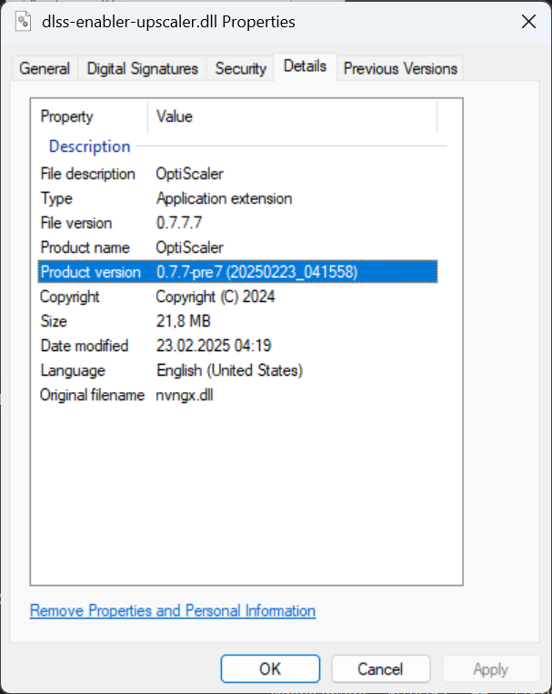

# RDR2 DLSS FG Modding Guide

## ⚠️ Important Notice - Current Status (July 2025)

> **DLSS-Enabler Compatibility Issues**: The current standard release of DLSS-Enabler has known stability issues with RDR2, particularly when Frame Generation is enabled. Users with RTX 3060 and similar cards may experience:
> - Game crashes within seconds of starting
> - Visual ghosting artifacts on textures
> - Memory access violations and DirectX 12 crashes
> 
> **Critical for All Games**: When using DLSS-Enabler with any game configuration, always update the OptiScaler library to the latest nightly build. The bundled OptiScaler version is often outdated and lacks essential compatibility fixes, new DLSS method support, and game-specific implementations that significantly improve stability and performance.
> 
> **Disable Conflicting Software**: All overlays and game extensions that might interfere with DLSS-Enabler should be disabled, including Steam Input, third-party overlays, and similar tools. These can cause unclear crashes and prevent proper game initialization.
> 
> **Recommended Solution**: Use the trunk release of DLSS-Enabler combined with the latest OptiScaler nightly build for optimal stability.

## Prerequisites
- **Graphics API**: Ensure you are using [DirectX 12](https://www.pcgamingwiki.com/wiki/Red_Dead_Redemption_2#Error:_unexpected_shutdown_due_to_lack_of_memory_.28ERR_GFX_D3D_DEFERRED_MEM.29). Both DLSS-Enabler and OptiScaler require DX12.
- **DLSS Settings**: Enable DLSS in the in-game settings with your preferred preset (Ultra Performance, Performance, Quality, etc.). If not configured, you'll receive a notification in the DLSS-Enabler overlay (hotkey `Insert`).
- **Texture Mods**: Avoid upscaled texture mods as they typically require Vulkan API. DX12 has known issues with large textures that can cause crashes.
- **Conflicting Software**: Disable all overlays, Steam Input, and third-party game extensions that might interfere with DLSS-Enabler operation.

## Description
This repository provides a comprehensive guide for enhancing Red Dead Redemption 2 with NVIDIA's Deep Learning Super Sampling (DLSS) and Frame Generation (FG) technology. It includes detailed installation instructions, recommended mods, troubleshooting tips, and the latest compatibility updates to optimize your gaming experience safely.

📋 **For common questions and detailed answers, see our [Frequently Asked Questions (FAQ)](FAQ.md)**

## Table of Contents
- [RDR2 DLSS FG Modding Guide](#rdr2-dlss-fg-modding-guide)
  - [⚠️ Important Notice - Current Status (July 2025)](#️-important-notice---current-status-july-2025)
  - [Prerequisites](#prerequisites)
  - [Description](#description)
  - [Table of Contents](#table-of-contents)
  - [Check Graphics API](#check-graphics-api)
    - [Via In-Game Settings](#via-in-game-settings)
    - [By Editing `settings.xml` File (alternative)](#by-editing-settingsxml-file-alternative)
  - [Foundation Mods Setup](#foundation-mods-setup)
  - [ScriptHookRDR2 V2](#scripthookrdr2-v2)
    - [Purpose](#purpose)
    - [Installation](#installation)
  - [Lenny's Mod Loader RDR](#lennys-mod-loader-rdr)
    - [Purpose](#purpose-1)
    - [Installation](#installation-1)
  - [DLSS Enhancement Setup](#dlss-enhancement-setup)
  - [DLSS-Enabler (Stable Trunk Release)](#dlss-enabler-stable-trunk-release)
    - [Purpose](#purpose-2)
    - [Installation (Recommended Trunk Release)](#installation-recommended-trunk-release)
  - [OptiScaler Integration](#optiscaler-integration)
    - [Purpose](#purpose-3)
    - [Installation](#installation-2)
  - [DLSS Library Upgrade](#dlss-library-upgrade)
    - [Purpose](#purpose-4)
    - [Installation using DLSS-Swapper](#installation-using-dlss-swapper)
  - [Version Verification](#version-verification)
    - [Checking OptiScaler Version](#checking-optiscaler-version)
    - [Manual Version Check via Windows Explorer](#manual-version-check-via-windows-explorer)
  - [Performance Optimization](#performance-optimization)
  - [Stutter Fix](#stutter-fix)
    - [Purpose](#purpose-5)
    - [How to Identify Which Version to Install for Your PC Config](#how-to-identify-which-version-to-install-for-your-pc-config)
  - [Best TAA and Visual Effects (optional)](#best-taa-and-visual-effects-optional)
  - [Troubleshooting](#troubleshooting)
    - [Common Crash Analysis](#common-crash-analysis)
    - [Solutions](#solutions)
    - [Common Interference Sources](#common-interference-sources)
    - [Test Configuration](#test-configuration)
  - [Scripts](#scripts)
    - [Example Directory Structure](#example-directory-structure)
    - [Using mods.md](#using-modsmd)
    - [Upcoming Content](#upcoming-content)
    - [Resources](#resources)

## Check Graphics API
To ensure you are using the correct Graphics API (DirectX 12) for DLSS-Enabler and OptiScaler, follow these steps:

### Via In-Game Settings
1. Start the game and go to the main menu settings.
2. Choose the "Graphics" card.
3. Navigate to the "Advanced Graphics" section, set "Advanced Settings" to "Unlocked".
4. Set the "Graphics API" to "DirectX 12".
5. Restart the game and verify that it is functioning correctly.

### By Editing `settings.xml` File (alternative)
1. Navigate to the [configuration file location](https://www.pcgamingwiki.com/wiki/Red_Dead_Redemption_2#Configuration_file.28s.29_location):
   ```
   %USERPROFILE%\Documents\Rockstar Games\Red Dead Redemption 2\Settings\
   ```
2. Open the `system.xml` file with a text editor like Notepad.
3. Find the line that specifies the graphics API:
   ```xml
   <API>kSettingAPI_Vulkan</API>
   ```
4. Change `Vulkan` to `DX12`:
   ```xml
   <API>kSettingAPI_DX12</API>
   ```
5. Save the file and close the text editor.
6. Launch the game.

For more details, you can refer to this guide: [Error: unexpected shutdown due to lack of memory (ERR_GFX_D3D_DEFERRED_MEM)](https://www.pcgamingwiki.com/wiki/Red_Dead_Redemption_2#Error:_unexpected_shutdown_due_to_lack_of_memory_.28ERR_GFX_D3D_DEFERRED_MEM.29).

## Foundation Mods Setup

These are the essential mods that enable other modifications to work properly in RDR2.

## [ScriptHookRDR2 V2](https://www.nexusmods.com/reddeadredemption2/mods/1472)
### Purpose
ScriptHookRDR2 V2 is a utility that enables the execution of custom scripts in Red Dead Redemption 2. It facilitates the loading and execution of .asi plugins, thereby enabling various modifications and enhancements for the game.

### Installation
1. Copy and replace the contents of "mods\2-ModLoader\ScriptHookRDR2 V2-*.zip\ScriptHook V2 2.0" into the game's main directory, where RDR2.exe is located.
2. Copy and replace the contents of "mods\2-ModLoader\Mod Loader-*.zip" into the game's main directory, where RDR2.exe is located.

## [Lenny's Mod Loader RDR](https://www.rdr2mods.com/downloads/rdr2/tools/76-lennys-mod-loader-rdr/)
### Purpose
Lenny's Mod Loader (LML) is a robust tool for managing and installing mods in Red Dead Redemption 2. It simplifies the process of adding and removing mods, ensuring compatibility and ease of use.

### Installation
1. Copy all files from the "ModLoader" directory into your RDR 2 game root directory so that files such as vfs.asi are in the same directory as your RDR2.exe.
2. The Mod Manager directory can be located anywhere and does not need to be inside the game directory.
3. New mods should be placed in the lml directory or use the "Download with Mod Manager" button on the mod website if supported (refer to the installation video for an example).

## DLSS Enhancement Setup

This section covers the installation of DLSS and Frame Generation technologies for RDR2. Due to recent compatibility issues, we recommend using specific versions and configurations.

## [DLSS-Enabler (Stable Trunk Release)](https://github.com/artur-graniszewski/DLSS-Enabler)

### Purpose
DLSS-Enabler enables NVIDIA's Deep Learning Super Sampling (DLSS) technology in games that don't natively support it. DLSS uses AI to upscale lower-resolution images to higher resolutions, improving performance while maintaining visual quality.

> [!WARNING]
> **Known Issues with Standard Release**: The current standard release of DLSS-Enabler has stability issues with RDR2:
> - Frequent crashes within seconds of game start when Frame Generation is enabled
> - Visual ghosting artifacts on all textures
> - Memory access violations (particularly on RTX 3060 systems)
> 
> **Solution**: Use the trunk release which offers better stability and compatibility.

### Installation (Recommended Trunk Release)
1. Download the [DLSS-Enabler Trunk Release v3.03.000.0](https://github.com/artur-graniszewski/DLSS-Enabler/releases/tag/3.03.000.0-trunk)
2. Find your RDR2 installation path (you can use the script `.\scripts\rdr2-helper.ps1 -FindLocation`)
3. Extract the trunk release files to your game directory
4. Install as `winmm.dll` instead of `version.dll` to avoid conflicts with ASI/LML loaders
5. Configure DLSS settings in-game before enabling the mod (optional, it might be configured via in-game overlay)
6. Remove `nvngx.ini` in game root directory (DLSS-Enabler with Optiscaler is using `OptiScaler.ini` file to store config state)

> [!NOTE]
> Using `winmm.dll` installation method prevents crashes with ASI/LML loaders. While `version.dll` generally works, `winmm.dll` is more stable with the current mod setup.

## [OptiScaler Integration](https://github.com/optiscaler/OptiScaler)

### Purpose
OptiScaler enhances visual quality and performance through optimized scaling algorithms. It supports Frame Generation (FG) and provides superior upscaling techniques when combined with DLSS-Enabler.

> [!IMPORTANT]
> **Always Update OptiScaler**: The OptiScaler library bundled with DLSS-Enabler is consistently outdated and lacks critical improvements. The latest nightly builds include:
> - **Enhanced Compatibility**: Fixed unsupported texture formats for FSR4, resolving crashes in previously incompatible games
> - **Advanced Features**: FSR 3.1.4 support, Anti-Lag 2 Vulkan support, and improved HUD fix stability
> - **Performance Optimizations**: Better frame time stability, improved FPS limiter, and reduced overhead with DX12 upscalers
> - **New Upscaling Methods**: FSR4 model selection, Unreal Engine XeSS input support, and custom spoofing options
> - **Game-Specific Fixes**: Dedicated improvements for No Man's Sky, Final Fantasy XIV, Indiana Jones, and Unity engine games
> 
> **Manual Update Required**: Always replace the bundled OptiScaler DLL with the latest nightly build for optimal performance and stability.

### Installation
1. Download the latest [OptiScaler Nightly Build](https://github.com/optiscaler/OptiScaler/releases/tag/nightly)
   - Direct link to current version: [OptiScaler v0.7.7-pre12_20250630](https://github.com/optiscaler/OptiScaler/releases/download/nightly/OptiScaler_v0.7.7-pre12_20250630.7z)
2. Extract the release archive
3. Locate `dlss-enabler-upscaler.dll` in the OptiScaler files
4. Rename `nvngx.dll` to `dlss-enabler-upscaler.dll`
5. Copy and replace the existing `dlss-enabler-upscaler.dll` in your RDR2 game directory
6. Run `DlssOverrides\EnableSignatureOverride.reg` if available

> [!IMPORTANT]
> **Version Verification**: After installation, verify you have the correct version by running the PowerShell command. You should see `0.7.7-pre12 (20250630_211128)` which indicates the June 30, 2025 build with latest stability fixes.

## DLSS Library Upgrade

### Purpose
RDR2 natively uses DLSS v2.2.10, which can be upgraded to the latest version (e.g., v3.10.3) for improved performance and visual quality.

### Installation using DLSS-Swapper
1. Install DLSS-Swapper via Windows Package Manager:
   ```
   winget install beeradmoore.dlss-swapper
   ```
2. Launch DLSS-Swapper
3. The application automatically detects installed games
4. Select Red Dead Redemption 2 from the list
5. Choose the latest DLSS version (e.g., v3.10.3) for the target library
6. Apply the update

> [!TIP]
> DLSS-Swapper automatically backs up your original DLSS files, making it safe to experiment with different versions.

## Version Verification

### Checking OptiScaler Version
To verify your OptiScaler installation is up-to-date, use PowerShell to check the DLL version:

```powershell
(Get-ItemProperty "C:\Program Files (x86)\Steam\steamapps\common\Red Dead Redemption 2\dlss-enabler-upscaler.dll").VersionInfo.ProductVersion
```

Expected output for current nightly build:
```
0.7.7-pre12 (20250630_211128)
```

> [!NOTE]
> **OptiScaler Version Updates**: The latest builds (0.7.7-pre12) include major stability improvements:
> - Fixed crashes with unsupported texture formats
> - Enhanced FSR4 compatibility and quality improvements
> - Improved Anti-Lag 2 support and frame time stability
> - Better support for Unreal Engine and Unity games
> 
> **Current Build Date**: June 30, 2025 (20250630_211128) - represents the latest stable nightly release with critical RDR2 compatibility fixes.

### Manual Version Check via Windows Explorer
You can also verify the version manually:
1. Navigate to your RDR2 game directory
2. Right-click on `dlss-enabler-upscaler.dll`
3. Select "Properties"
4. Check the "Details" tab for version information



## Performance Optimization

## [Stutter Fix](https://www.nexusmods.com/reddeadredemption2/mods/1502)
### Purpose
This mod increases the memory pools related to texture streaming to help mitigate stuttering issues since the Naturalist update by allocating more VRAM for texture streaming.

### How to Identify Which Version to Install for Your PC Config
1. **Start with the Smallest Poolsize (3750)**: This is the safest option and uses the least VRAM.
2. **Increase Gradually**: If stuttering persists, try higher pool sizes (4500, 6000, etc.).
3. **Monitor Performance**: Ensure the pool size does not exceed your available VRAM to avoid errors.

For more detailed information, refer to the mod description.

## [Best TAA and Visual Effects (optional)](https://www.nexusmods.com/reddeadredemption2/mods/2188)

The rest of the preferred mods are available in [mods.md](./mods.md).

## Troubleshooting

### Common Crash Analysis
Based on error analysis from RTX 3060 systems, the following issues are common:

**Error Categories (by frequency):**
- 15x RDR2 Breakpoint Exception (debugging/anti-cheat related)
- 6x Access Violation (memory protection errors)
- 3x Application Hang
- 3x AMD FidelityFX DX12 Crash
- 2x DirectX 12 Crash
- 2x RDR2 Fatal Exit

**Faulting Modules:**
- 18x RDR2.exe (main game executable)
- 3x amd_fidelityfx_dx12.dll
- 2x D3D12.DLL

### Solutions
1. **Use Trunk Release**: Always use the DLSS-Enabler trunk release instead of standard releases
2. **Update OptiScaler**: Manually update the OptiScaler DLL to the latest nightly build
3. **Disable Conflicting Software**: Turn off Steam Input, overlays (Steam, Discord, NVIDIA, etc.), and any third-party game enhancement tools
4. **Disable Frame Generation**: If crashes persist, temporarily disable FG until you verify base DLSS functionality
5. **Monitor VRAM Usage**: Ensure your graphics card has sufficient VRAM for the selected settings

### Common Interference Sources
- **Steam Input**: Known to prevent game startup with DLSS-Enabler enabled
- **Third-party Overlays**: Discord, MSI Afterburner, NVIDIA GeForce Experience overlay
- **Game Enhancement Tools**: ReShade, ENB mods, or similar graphics modification software
- **Antivirus Software**: Some antivirus programs may interfere with DLL injection

### Test Configuration
This guide has been tested on the following configuration:
- **CPU**: Intel Core i7-12700 @ 2.1GHz
- **GPU**: NVIDIA GeForce RTX 3060
- **RAM**: 64GB (15GB used during testing)
- **OS**: Windows 11 Pro 64-bit
- **Motherboard**: ASRock B660M-ITX/ac

## Scripts
This repository includes several PowerShell scripts to assist with mod management and installation:

- `Convert-CSVMarkdown.ps1`: Converts between CSV and Markdown formats for a list of hyperlinks with titles and paragraphs/sections. This script includes a verbose flag for detailed logging and a default file argument for the source file.
- `Create-Subdirs.ps1`: Creates subdirectories in a target directory based on a list of directory names provided in a separate file. This script includes verbose logging and prints each action for parsing, changing values, creating directories, and handling errors.
- `rdr2-helper.ps1`: Checks for the installation of Red Dead Redemption 2 on different PC platforms (Steam, Rockstar Games Launcher, Epic Games Store). If the game is not found in the default paths, it searches for the game directory on the C drive and all available drives. It supports verbose logging and can copy the game directory path to the clipboard.

### Example Directory Structure
The `Create-Subdirs.ps1` script generates a directory structure for all mods based on each check as steps. This helps ensure that each step is completed before moving on to the next part of the mod installation process.

[Create-Subdirs-tree.log](./output/Create-Subdirs-tree.log)

### Using mods.md
The `mods.md` file is designed to help you keep track of the mods you have installed and tested. It includes columns for:

- **Hyperlinks**: Direct links to the mod pages on Nexus Mods.
- **Installed**: Mark the mods you have already installed to avoid losing track.
- **Check**: Manually test if the game is working properly after installing each mod, e.g., through a benchmark in graphical settings.

### Upcoming Content
A gameplay video demonstrating the enhancements and optimizations will be available at a later time.

### Resources
- [DLSS-Enabler Repository](https://github.com/artur-graniszewski/DLSS-Enabler)
- [DLSS-Enabler Trunk Release](https://github.com/artur-graniszewski/DLSS-Enabler/releases/tag/3.03.000.0-trunk)
- [OptiScaler Repository](https://github.com/optiscaler/OptiScaler)
- [OptiScaler Nightly Builds](https://github.com/optiscaler/OptiScaler/releases/tag/nightly)
- [DLSS-Swapper](https://github.com/beeradmoore/dlss-swapper)
- [Nexus Mods - Red Dead Redemption 2](https://www.nexusmods.com/reddeadredemption2)
- [RDR2 Mods](https://www.rdr2mods.com/downloads/rdr2/)
- [PCGamingWiki - Red Dead Redemption 2](https://www.pcgamingwiki.com/wiki/Red_Dead_Redemption_2)
- [Reddit - RDR2 Recommended Graphical Settings](https://www.reddit.com/r/PCRedDead/comments/yn4jhz/rdr2_overall_recommended_graphical_settings/)
- [YouTube - RDR2 Graphical Settings](https://www.youtube.com/watch?v=Hyzp4zRivis)
- [YouTube - I modded RDR2 into a PERFECT GAME | Synth](https://www.youtube.com/watch?v=WBGLf3T6-hc)